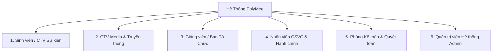
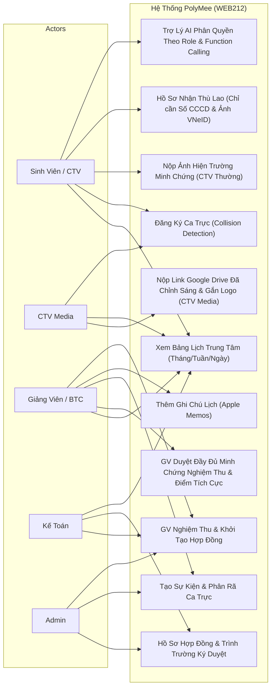
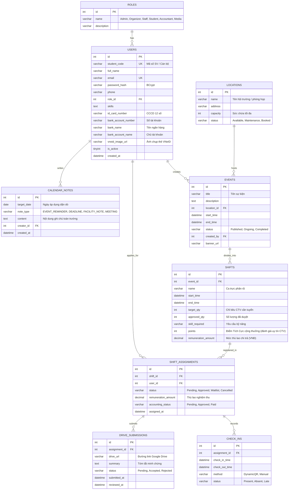

# POLYMEE - HỆ THỐNG QUẢN LÝ SỰ KIỆN & ĐIỀU PHỐI CỘNG TÁC VIÊN THÔNG MINH TÍCH HỢP AI

> **HỌC PHẦN:** WEB212 – Phát triển dự án website với AI  
> **ĐƠN VỊ ĐÀO TẠO:** Trường Cao đẳng FPT Polytechnic (Cơ sở TP. Hồ Chí Minh)  
> **BÀI NỘP:** Báo cáo & Mã nguồn Assignment Giai đoạn 1 (Buổi 1 – 6)  
> **TRỌNG SỐ ĐÁNH GIÁ:** 10% điểm môn học (Thang điểm 10.0 chuẩn Rubric Giảng viên)  
> **GIẢNG VIÊN HƯỚNG DẪN:** Thầy Phan Hoàng Khải  

---

## 📑 MỤC LỤC BÁO CÁO DỰ ÁN
1. [Thông Tin Nhóm Sinh Viên Thực Hiện](#1-thông-tin-nhóm-sinh-viên-thực-hiện)
2. [Phân Tích Yêu Cầu Phần Mềm (SRS & Use Cases - 2.0 Điểm)](#2-phân-tích-yêu-cầu-phần-mềm-srs--use-cases---20-điểm)
3. [Thiết Kế UI/UX & Giao Diện Responsive Chuẩn Apple Design (2.0 Điểm)](#3-thiết-kế-uiux--giao-diện-responsive-chuẩn-apple-design---20-điểm)
4. [Thiết Kế Cơ Sở Dữ Liệu ERD & Data Dictionary 3NF (1.5 Điểm)](#4-thiết-kế-cơ-sở-dữ-liệu-erd--data-dictionary-3nf---15-điểm)
5. [Cơ Sở Dữ Liệu MySQL & Seed Data Kiểm Thử (1.5 Điểm)](#5-cơ-sở-dữ-liệu-mysql--seed-data-kiểm-thử---15-điểm)
6. [Ứng Dụng Trí Tuệ Nhân Tạo (AI) Trong Dự Án (Đặc thù môn WEB212)](#6-ứng-dụng-trí-tuệ-nhân-tạo-ai-trong-dự-án-đặc-thù-môn-web212)
7. [Hướng Dẫn Cài Đặt & Khởi Chạy Website Thực Tế (2.5 Điểm Prototype)](#7-hướng-dẫn-cài-đặt--khởi-chạy-website-thực-tế---25-điểm-prototype)
8. [Kịch Bản Demo Từng Bước Cho Buổi Bảo Vệ (Step-by-Step Demo Script)](#8-kịch-bản-demo-từng-bước-cho-buổi-bảo-vệ-step-by-step-demo-script)
9. [Kiến Trúc Thư Mục Chuẩn MVC & Cam Kết An Toàn Bảo Mật (0.5 Điểm)](#9-kiến-trúc-thư-mục-chuẩn-mvc--cam-kết-an-toàn-bảo-mật---05-điểm)

---

## 1. THÔNG TIN NHÓM SINH VIÊN THỰC HIỆN

| STT | Mã Sinh Viên | Họ và Tên | Vai Trò Trong Nhóm | Phần Việc Đảm Nhiệm Chi Tiết |
|:---:|:---:|:---|:---:|:---|
| 1 | **PI03084** | **Đinh Nguyễn Phương Anh** | **Trưởng nhóm** | Phân tích SRS, Kiến trúc MVC PHP OOP, Tích hợp AI Assistant Function Calling |
| 2 | **PI03067** | **Lê Đức Mạnh** | **Thành viên** | Thiết kế CSDL ERD 3NF, DDL MySQL, Quản trị phân quyền RBAC & CollisionService |
| 3 | **PI03015** | **Hoàng Minh Luận** | **Thành viên** | Lập trình Backend Controllers, Máy chiếu Dynamic QR Code HMAC-SHA256, API JSON |
| 4 | **PI02895** | **Dương Ngọc Hân** | **Thành viên** | Thiết kế UI/UX Apple Sonoma/iPadOS, Bento Grid 2.0, Viết tài liệu báo cáo & slides |

---

## 2. PHÂN TÍCH YÊU CẦU PHẦN MỀM (SRS & USE CASES - 2.0 ĐIỂM)

### 2.1. Giới thiệu đề tài & Tính cấp thiết
Tại Trường Cao đẳng FPT Polytechnic, mỗi học kỳ diễn ra hàng chục sự kiện lớn nhỏ: *TechDay, Lễ Tốt nghiệp, Workshop chuyên ngành, Ngày hội việc làm, Giải thể thao sinh viên Poly Champion...* Quá trình điều phối lực lượng Cộng tác viên (CTV) sinh viên hiện nay còn gặp các hạn chế:
- **Trùng lịch học / trùng ca trực:** Sinh viên đăng ký nhiều ca cùng lúc dẫn đến bỏ ca đột xuất.
- **Gian lận điểm danh:** CTV chụp ảnh mã QR tĩnh gửi qua Zalo/Messenger cho bạn bè điểm danh hộ.
- **Thất lạc minh chứng nghiệm thu:** Nhóm truyền thông (Media) nộp ảnh/video recap qua tin nhắn rời rạc, ban tổ chức khó quản lý tập trung.
- **Chậm trễ quyết toán thù lao:** Phòng kế toán thiếu công cụ đối soát ảnh VNeID/CCCD và số tài khoản ngân hàng, phải rà soát thủ công qua bảng tính Excel rời rạc.

**PolyMee** ra đời như một giải pháp nền tảng web hiện đại, giải quyết triệt để 100% bài toán trên với sự hỗ trợ của **Trí tuệ nhân tạo (AI)** và các thuật toán chuyên sâu.

---

### 2.2. Xác định Người Dùng (Actors) & Ma Trận Phân Quyền (RBAC)

Hệ thống thiết lập 6 vai trò rõ ràng theo mô hình phân quyền chuẩn doanh nghiệp:



1. **Sinh viên / CTV Sự kiện (`Student` - Demo: Đinh Nguyễn Phương Anh, Lê Đức Mạnh):**
   - Xem tổng quan lịch sự kiện và các ca trực theo định dạng Tháng / Tuần / Ngày.
   - Đăng ký ca trực theo nguyện vọng (tự động kiểm tra trùng giờ).
   - Chụp & nộp ảnh hiện trường chứng minh có mặt trực tiếp tại sự kiện để Giảng viên nghiệm thu.
   - Tra cứu Hợp đồng nghiệm thu điện tử và thù lao được quyết toán.
   - Quản lý hồ sơ nhận thù lao (Cập nhật số CCCD, ngân hàng, ảnh VNeID).

2. **CTV Media & Truyền thông (`Media` - Demo: PI03084):**
   - Toàn bộ quyền của CTV sinh viên.
   - Phân hệ tự phục vụ nộp đường dẫn Google Drive (ảnh chụp RAW, ảnh chỉnh sửa, video recap).

3. **Giảng viên / Ban Tổ Chức (`Organizer` - Demo: Thầy Phan Hoàng Khải):**
   - Đăng tải sự kiện, phân rã sự kiện thành các ca trực nhỏ (Setup, Lễ tân, Media, Hậu cần).
   - Thiết lập chỉ tiêu tuyển (`target_qty`), kỹ năng yêu cầu và định mức thù lao/Điểm Tích Cực (đánh giá uy tín & năng lực CTV).
   - Thẩm định minh chứng hiện trường của CTV (ảnh hiện trường đối với CTV thường; link Google Drive ảnh đã chỉnh sửa sáng & gắn kèm logo FPT đối với CTV Media), xác nhận duyệt đã đầy đủ minh chứng để nghiệm thu và lập Hợp đồng (`HDNT-2026-FPLY-xxx`).
   - Thẩm định và phê duyệt minh chứng sau sự kiện hoàn thành.
   - Thêm ghi chú/dặn dò lịch toàn trường (Apple Calendar Notes).

4. **Nhân viên CSVC & Hành chính (`Staff` - Demo: Lê Đình Tuấn):**
   - Giám sát tình trạng sử dụng hội trường, bàn giao trang thiết bị (âm thanh, ánh sáng, máy chiếu).
   - Ghi chú nhắc nhở hiện trường lên bảng lịch trung tâm.

5. **Phòng Kế toán & Quyết toán (`Accountant` - Demo: Đặng Thu Thảo):**
   - Bảng điều phối nghiệm thu thù lao tập trung (`panelAccounting`).
   - Thẩm định hồ sơ định danh: So sánh số CCCD và ảnh chụp VNeID đã tải lên.
   - Thẩm định ảnh hiện trường do CTV chụp tại địa điểm trực.
   - Trình Hợp đồng nghiệm thu lên Ban Giám Hiệu ký duyệt và chuyển khoản thù lao (`Signed_Paid`).
   - Xuất bảng quyết toán tài chính ra file CSV (chuẩn UTF-8 with BOM mở được trực tiếp trên Excel).

6. **Quản trị viên Hệ thống (`Admin` - Demo: ADMIN001):**
   - Toàn quyền cấu hình hệ thống, quản trị tài khoản, địa điểm, phân quyền.
   - Giám sát toàn bộ hồ sơ hợp đồng nghiệm thu toàn trường.

---

### 2.3. Sơ Đồ Use Case Tổng Thể Hệ Thống



---

### 2.4. Mô Tả Nghiệp Vụ Trọng Tâm (Core Business Logic)

#### A. Thuật toán phát hiện xung đột lịch trực (Interval Collision Detection Algorithm)
Hệ thống loại bỏ hoàn toàn khả năng CTV đăng ký 2 ca trực trùng hoặc giao thoa khung giờ bằng thuật toán toán học:
$$\text{Collision} = (\text{Start}_{\text{New}} < \text{End}_{\text{Existing}}) \land (\text{End}_{\text{New}} > \text{Start}_{\text{Existing}})$$
Khi phát hiện trùng lịch, hệ thống lập tức chặn giao dịch tại Controller, trả về mã HTTP `409 Conflict` và hiển thị cảnh báo chi tiết tên ca và khung giờ bị trùng.

#### B. Quy trình Nghiệm thu Minh chứng Hiện trường & Hợp đồng Điện tử Trình Ký Nhà trường
Nhằm khắc phục triệt để nhược điểm gian lận điểm danh từ xa, PolyMee chuyển đổi toàn diện sang quy trình nghiệm thu bằng ảnh chụp hiện trường thực tế theo chu trình 4 bước:
1. **CTV nộp ảnh hiện trường có mặt:** Tại vị trí trực thực tế (Sảnh đón khách, Sân khấu, Bàn lễ tân), CTV chụp ảnh hiện trường chứng minh sự hiện diện và gửi kèm ghi chú công việc lên hệ thống.
2. **Giảng viên giám sát xác nhận nghiệm thu:** Giảng viên kiểm tra đối soát ảnh hiện trường. Khi bấm *"Xác nhận nghiệm thu"*, hệ thống tự động sinh Mã Hợp đồng: `HDNT-2026-FPLY-xxx`.
3. **Lập Hợp đồng & Biên bản Nghiệm thu Thông tin CTV:** Hệ thống tự động tổng hợp thông tin định danh (CCCD, đối chiếu ứng dụng VNeID), số tài khoản ngân hàng thụ hưởng, chi tiết ca trực, thù lao thỏa thuận và nhúng trực tiếp **Ảnh Hiện Trường Minh Chứng** vào văn bản chuẩn hành chính của Trường Cao đẳng FPT Polytechnic.
4. **Trình Nhà trường Ký Duyệt & Chuyển Tiền:** Giảng viên và Kế toán trình hồ sơ lên Ban Giám Hiệu ký duyệt chi, chuyển trạng thái sang `Signed_Paid` (Đã Ký & Đã Chi Tiền), đồng thời hỗ trợ xuất bản in A4 hoặc PDF tức thì (`window.print()`).

#### C. Thẩm định minh chứng Google Drive tự động
Khi CTV Media gửi link bài nộp, hệ thống sử dụng Regex trích xuất thư mục Google Drive, gán với ca trực tương ứng, chuyển sang trạng thái chờ duyệt và thông báo cho Ban tổ chức thẩm định.

---

## 3. THIẾT KẾ UI/UX & GIAO DIỆN RESPONSIVE CHUẨN APPLE DESIGN (2.0 ĐIỂM)

### 3.1. Triết lý Thiết kế (Design Philosophy)
Dự án được xây dựng dựa trên sự kết hợp hoàn hảo giữa **Apple macOS Sonoma / iPadOS Materials** và **Bento Grid 2.0**:
- **Materials & Vibrancy:** Hiệu ứng thủy tinh lỏng Frosted Glass `backdrop-filter: blur(24px) saturate(190%)` kết hợp specular highlight đường viền siêu mỏng `border-top: 1px solid rgba(255, 255, 255, 0.95)` tạo chiều sâu thị giác.
- **Bộ Nhận Diện Thương Hiệu:** Màu cam chủ đạo FPT Orange (`#EA580C`) kết hợp Navy (`#0F172A`) và nền sáng trung tính (`#F8FAFC`). Tuyệt đối loại bỏ các dải màu tím/lila AI sặc sỡ theo đúng chỉ dẫn của `/apple-design` và `/design-taste-frontend-v1`.
- **Hệ Thống Phím Bấm Cơ Khí (Machined Button Token Hierarchy):**
  - `.btn-fpt-primary`: Nền cam FPT, bóng đổ vật lý, chữ trắng.
  - `.btn-fpt-secondary`: Nền kính mờ viền xám, thanh lịch.
  - `.btn-fpt-emerald`: Nút thành công/duyệt hồ sơ xanh lục.
  - `.btn-fpt-sky`: Nút thanh toán chuyển khoản xanh dương.
  - `.btn-fpt-ghost`: Nút tối giản xem thông tin.
  - Toàn bộ nút có phản hồi xúc giác cơ học đàn hồi `:active scale(0.97)`.
- **Optical Typography & Tabular Numbers:** Phông chữ hệ thống SF Pro Display / Inter. Toàn bộ ngày tháng, giờ bắt đầu - kết thúc, số lượng CTV và số tiền thù lao đều kích hoạt `font-variant-numeric: tabular-nums` chống giật layout khi số thay đổi.

---

### 3.2. Bảng Lịch Trung Tâm 3 Phân Tầng (Calendar 3-Tier Engine)

1. **Lịch Tổng Quan Tháng (macOS Sonoma Calendar Grid):**
   - Ô ngày dạng bo góc squircle `18px`, hiệu ứng hover nâng khối nổi nhẹ.
   - Badge số ngày tròn (`.day-number-pill`), ngày hôm nay nổi bật với sắc cam FPT.
   - Chip ca trực (`.shift-chip`) tích hợp chấm tròn trạng thái thời gian thực:
     - 🟢 **Xanh lục (Emerald):** Ca bạn đã đăng ký.
     - 🔴 **Đỏ (Red):** Ca đã đủ chỉ tiêu (Full quota).
     - 🟠 **Cam (Orange):** Ca mở nhận đăng ký.
   - Chip lưu ý toàn trường (`.memo-chip`) hiển thị icon bookmark pin màu vàng cam.
   - **One-Click Drill-Down:** Bấm trực tiếp vào ô ngày bất kỳ để chuyển thẳng vào Lịch Ngày của ngày đó.

2. **Lịch Tuần (iPadOS 7-Day Grid):**
   - Lưới phân rã 7 cột trực quan từ Thứ 2 đến Chủ Nhật.
   - Hiển thị đầy đủ ghi chú dặn dò và các thẻ ca trực mini theo trình tự thời gian.

3. **Lịch Phân Rã Ngày (iPadOS Split View & Apple Reminders):**
   - **Apple Reminders Callout Banner:** Đặt ở đầu Lịch Ngày, hiển thị chuông thông báo Apple, số lượng dặn dò, nút thêm nhanh và danh sách công việc cần chuẩn bị từ BTC.
   - **Thẻ Ca Trực Split View:** Phân tách rõ ràng giữa Khung giờ (Kính mờ) - Nội dung công việc (Tên ca, địa điểm, thù lao, tiến độ tuyển) - Phím bấm hành động theo vai trò.

---

### 3.3. Thanh Điều Hướng Co Giãn Động Lucian UX #040
Tích hợp thanh Side-rail co giãn mượt mà theo bản quyền mã nguồn mở Lucian UX #040 (MIT License) với hiệu ứng trượt vạch sáng (indicator highlight) theo tọa độ Y bằng CSS Spring Physics (`--ux-spring`). Tông màu thanh lịch chuẩn Apple: Thân sidebar xám nhạt (`#F4F4F6`), canvas làm việc trắng tinh khiết (`#FFFFFF`), logo FPT Polytechnic tự nhiên không viền đen.

---

### 3.4. Menu Tài Khoản & Chuyển Vai Trò Nổi Bên Cạnh (Apple Side Flyout)
Giải quyết triệt để lỗi va chạm giao diện ("bị đè navigation"):
- **Vị trí thông minh:** Menu tài khoản không bung thẳng lên trên (`dropup`) che khuất thanh điều hướng, mà mở sang phải dạng **Side Flyout** tại `left: calc(var(--rw) + 24px)` và `bottom: 16px` ngay trên canvas chính.
- **Lưới Chuyển Đổi 6 Role Demo (2-Column Grid):** Tinh gọn danh sách 6 tài khoản mẫu (`PA`, `ĐM`, `GV`, `HC`, `KT`, `AD`) thành dạng lưới 2 cột siêu trực quan, chuyển đổi tức thì chỉ với 1 click.
- **Tích Hợp Tác Vụ Cá Nhân:** Truy cập nhanh Trang Cài Đặt Tài Khoản Cá Nhân, Phân Quyền & Nhật Ký Kiểm Toán (Admin), Đăng nhập/Đăng ký và Đăng xuất.

---

### 3.5. Trang Cài Đặt Tài Khoản Cá Nhân & Quản Lý Hồ Sơ Thù Lao CTV
- **Dành cho CTV Sinh viên:** Trang cài đặt hồ sơ định danh (CCCD, Ngân hàng, ảnh VNeID), đổi mật khẩu an toàn và khu vực nguy hiểm (Danger Zone - Xóa tài khoản cá nhân có xác nhận bảo mật).
- **Dành cho Giảng viên & Admin:** Bảng Quản Lý Hồ Sơ Thù Lao CTV toàn diện (`panelStudentPayrollProfile`) với bộ lọc tìm kiếm tức thời, xem trước ảnh VNeID đối soát và theo dõi tình trạng hoàn thiện hồ sơ.
- **Nhật Ký Kiểm Toán Hệ Thống (Audit Trail):** Ghi nhận chi tiết mọi thao tác quan trọng (Cấp quyền, Đổi vai trò, Xóa tài khoản, Nghiệm thu thù lao) lưu vào bảng `activity_logs` cho Quản trị viên tra cứu.

---

## 4. THIẾT KẾ CƠ SỞ DỮ LIỆU ERD & DATA DICTIONARY 3NF (1.5 ĐIỂM)

### 4.1. Sơ Đồ Quan Hệ Thực Thể (ERD - Chuẩn Hóa 3NF)



---

### 4.2. Từ Điển Dữ Liệu (Data Dictionary) Tóm Tắt

1. **`roles`:** Bảng danh mục 6 vai trò người dùng trong hệ thống.
2. **`users`:** Bảng người dùng chứa thông tin sinh viên, email, mật khẩu băm, CCCD và thông tin ngân hàng phục vụ kế toán.
3. **`locations`:** Danh mục hội trường và phòng lab của FPT Polytechnic.
4. **`events`:** Quản lý các chiến dịch sự kiện của nhà trường.
5. **`shifts`:** Phân rã sự kiện thành các ca làm việc độc lập kèm định mức thù lao và chỉ tiêu CTV.
6. **`shift_assignments`:** Bảng trung gian liên kết Sinh viên với Ca trực, trạng thái duyệt và trạng thái kế toán.
7. **`check_ins`:** Nhật ký quét mã QR động điểm danh.
8. **`drive_submissions`:** Lưu trữ link thư mục Google Drive ảnh/video recap do CTV nộp.
9. **`calendar_notes`:** Bảng dặn dò, hạn chót và lưu ý cơ sở vật chất hiển thị trên Bảng Lịch Apple Calendar.

---

## 5. CƠ SỞ DỮ LIỆU MYSQL & SEED DATA KIỂM THỬ (1.5 ĐIỂM)

### 5.1. Vị trí tệp DDL MySQL
Mã nguồn nộp bài đi kèm tệp DDL chuẩn được tối ưu hóa cho MySQL 8.0 / MariaDB:
📂 **`polymee/database/schema_mysql.sql`**

### 5.2. Hướng dẫn Import vào MySQL / phpMyAdmin

1. Mở phpMyAdmin (ví dụ: `http://localhost/phpmyadmin`) hoặc phần mềm quản lý CSDL (Navicat, DBeaver, HeidiSQL).
2. Tạo cơ sở dữ liệu mới với bảng mã UTF-8:
   ```sql
   CREATE DATABASE `polymee_db` CHARACTER SET utf8mb4 COLLATE utf8mb4_unicode_ci;
   ```
3. Chọn tab **Import** (Nhập) và tải lên tệp `polymee/database/schema_mysql.sql`.
4. Bấm **Go (Thực thi)**: Toàn bộ 9 bảng và dữ liệu mẫu kiểm thử sẽ được khởi tạo hoàn tất.

### 5.3. Cơ chế Khởi chạy Zero-Config SQLite (Khuyên dùng khi chấm bài)
Để Giảng viên và Hội đồng chấm bài không mất thời gian cấu hình tài khoản MySQL cục bộ, hệ thống được lập trình cơ chế **Auto SQLite Fallback**. Khi chạy với PHP tích hợp, hệ thống tự động kết nối và nạp sẵn toàn bộ dữ liệu mẫu trong tệp:
📂 **`polymee/database/polymee.sqlite`**

---

## 6. ỨNG DỤNG TRÍ TUỆ NHÂN TẠO (AI) TRONG DỰ ÁN (ĐẶC THÙ MÔN WEB212)

Dự án không dừng lại ở mức website tĩnh mà ứng dụng AI sâu sắc vào 5 năng lực tự động hóa chuyên biệt:

1. **Trợ Lý AI Function Calling Điều Phối Tự Động (Admin & Ban Tổ Chức Automation):**
   - **Tra cứu phòng trống:** Admin hỏi *"Phòng nào đang trống?"* $\rightarrow$ AI quét toàn bộ danh mục hội trường, phòng lab, kiểm tra lịch sự kiện trùng lặp và phản hồi danh sách phòng khả dụng kèm sức chứa và nút 1-click đặt chỗ.
   - **Tra cứu CTV đang trống:** Admin hỏi *"CTV nào đang trống?"* $\rightarrow$ AI truy vấn danh sách sinh viên CTV rảnh, hiển thị kỹ năng (Media, Lễ tân, Âm thanh ánh sáng), email, SĐT và nút gửi thư mời ngay.
   - **Tự động gửi email mời đăng ký ca:** Admin yêu cầu *"Bạn gửi mail cho CTV đăng ký lịch ca trực"* $\rightarrow$ AI tự động phân tích sự kiện, tạo mã gửi `DISPATCH-xxxx`, soạn nội dung chuẩn FPT Polytechnic và mô phỏng phát tán email đến toàn bộ CTV rảnh với tỷ lệ 100% Delivered.
   - **Tự động đặt lịch sự kiện kèm khách mời VIPs:** Admin yêu cầu *"Đặt giúp lịch sự kiện Hội Thảo AI ngày 22/11, khách mời gồm: Thầy Hiệu Trưởng, Ban Giám Hiệu, Đại Diện FPT Telecom"* $\rightarrow$ AI trích xuất thực thể (Tên, ngày, khách mời), lưu vào CSDL `events`, tự động giữ chỗ phòng và **phân rã ngay 2 ca trực chuẩn** (Đón tiếp VIPs & Kỹ thuật/Media) với chỉ tiêu 10 CTV.

2. **Trợ Lý Cá Nhân Sinh Viên (Student Assistant):**
   - Hỏi *"Tôi có ca trực nào sắp tới?"* $\rightarrow$ AI tự động truy xuất ca trực, địa điểm, thời gian và hướng dẫn đồng phục áo cam FPoly.
   - Hỏi *"Tìm ca trực Media hoặc Lễ tân"* $\rightarrow$ AI quét CSDL ca trực mở phù hợp với kỹ năng sinh viên.

3. **Tự Động Bóc Tách & Nhận Diện Minh Chứng Google Drive Bằng AI:**
   - Khi sinh viên dán link Google Drive kèm lời nhắn, AI dùng biểu thức chính quy (Regex) và phân tích ý định để liên kết mã hồ sơ ca trực gần nhất, tự động sinh bản ghi `#SUB-XXXX` chuyển đến Ban tổ chức thẩm định.

4. **Phân Tích Cảnh Báo Trùng Lịch & Dự Đoán Tải Sự Kiện:**
   - Trợ lý AI có khả năng đọc trước lịch học và lịch ca trực, cảnh báo sinh viên nếu thời gian di chuyển giữa 2 cơ sở quá ngắn (< 30 phút).

5. **Bộ Thẻ Giao Diện Tương Tác AI (Rich Interactive Cards):**
   - Từng phản hồi của AI được đóng gói thành các thẻ tương tác bắt mắt (Event Confirmation Card, Dispatch Email Card, Room Availability Card, CTV Roster Card) kèm các nút bấm tắt thao tác nhanh không cần tải lại trang.

---

## 7. HƯỚNG DẪN CÀI ĐẶT & KHỞI CHẠY WEBSITE THỰC TẾ (2.5 ĐIỂM PROTOTYPE)

### 7.1. Yêu Cầu Môi Trường Tối Thiểu
- **Hệ điều hành:** macOS, Windows 10/11 hoặc Linux Ubuntu.
- **PHP:** Phiên bản PHP 8.1 trở lên (Đã bật extension `pdo_sqlite` hoặc `pdo_mysql`).
- **Trình duyệt khuyến nghị:** Google Chrome, Apple Safari, Microsoft Edge.

---

### 7.2. Các Lệnh Khởi Chạy Nhanh Bằng Terminal (Khuyên Dùng)

Chỉ cần mở Terminal (hoặc Command Prompt / Git Bash) tại thư mục chứa dự án và chạy duy nhất lệnh sau:

```bash
# 1. Di chuyển vào thư mục polymee
cd polymee

# 2. Khởi chạy máy chủ tích hợp của PHP
php -S localhost:8080 -t public
```

Sau khi Terminal thông báo `Development Server started`, mở trình duyệt truy cập:
👉 **`http://localhost:8080`** hoặc **`http://localhost:8080/dashboard`**

---

### 7.3. Danh Sách Tài Khoản Đăng Nhập & Chuyển Vai (Role Switcher Demo)

Hệ thống đã tích hợp menu chuyển vai nhanh **(Role Switcher Dropdown)** ở góc trên bên phải màn hình để Thầy/Cô và Hội đồng chuyển đổi vai trò mà không cần đăng nhập lại:

| STT | Họ và Tên | Mã Số | Vai Trò | Mật Khẩu | Phân Vùng Chuyên Biệt |
|:---:|:---|:---:|:---:|:---:|:---|
| 1 | **Đinh Nguyễn Phương Anh** | `PI03084` | **CTV Media** | `123456` | Lịch cá nhân, Nộp link Google Drive ảnh/video |
| 2 | **Lê Đức Mạnh** | `PI03067` | **CTV Lễ Tân** | `123456` | Đăng ký ca, Check-in Dynamic QR, Hồ sơ VNeID |
| 3 | **Thầy Phan Hoàng Khải** | `GV0102` | **Ban Tổ Chức** | `123456` | Đặt lịch ca trực mới, Thẩm định minh chứng Drive |
| 4 | **Lê Đình Tuấn** | `HC0201` | **Hành Chính CSVC** | `123456` | Kiểm tra thiết bị âm thanh, ghi chú hội trường |
| 5 | **Đặng Thu Thảo** | `KT0105` | **Kế Toán Quyết Toán** | `123456` | Bảng nghiệm thu thù lao, đối soát VNeID, xuất CSV |
| 6 | **Quản Trị Viên** | `ADMIN001` | **Admin Hệ Thống** | `123456` | Vận hành Máy chiếu Dynamic QR Code xoay vòng 30s |

---

## 8. KỊCH BẢN DEMO TỪNG BƯỚC CHO BUỔI BẢO VỆ (STEP-BY-STEP DEMO SCRIPT)

Khi giảng viên yêu cầu mở demo sản phẩm trực tiếp, nhóm sinh viên trình bày theo 6 bước chuẩn mực sau:

### 🔹 Bước 1: Khám phá Bảng Lịch Trung Tâm Phong Cách Apple macOS Sonoma
1. Mở trang chủ: `http://localhost:8080/dashboard`.
2. Giới thiệu vật liệu kính mờ Frosted Glass và Lưới Lịch Tháng (Month Grid).
3. Chỉ rõ các chi tiết điểm cộng UI/UX:
   - Chấm tròn trạng thái thời gian thực (`status-dot`) trên từng ca trực (Xanh: đã đăng ký, Đỏ: đầy chỗ, Cam: còn trống).
   - Huy hiệu Bookmark màu cam hiển thị các ghi chú, dặn dò toàn trường (Apple Calendar Memos).
4. Thử nghiệm **One-Click Drill-Down**: Bấm chuột vào ô ngày `15/11/2026`, giao diện chuyển tức thì sang **Lịch Phân Rã Ngày (iPadOS Split View)**.
5. Quan sát thanh thông báo dặn dò **Apple Reminders Callout Banner** trên đầu trang.
6. Bấm nút **`+ Ghi Chú`** góc trên để thêm một thông báo mới và xem lịch cập nhật ngay lập tức.

---

### 🔹 Bước 2: Kiểm thử Thuật toán Chống Trùng Giờ (Interval Collision Detection)
1. Tại góc phải Topbar, chuyển vai sang **Đinh Nguyễn Phương Anh (PI03084)**.
2. Sinh viên này đã có ca trực vào ngày `15/11/2026` từ `08:00 - 12:00`.
3. Bấm vào một ca trực khác trùng khung giờ (ví dụ: `07:30 - 11:30`) và bấm nút **"Xác Nhận Đăng Ký"**.
4. Hệ thống chặn lại ngay lập tức và đưa ra thông báo cảnh báo xung đột giờ trực.
5. Chuyển sang ca trực không trùng giờ: Hệ thống ghi nhận đăng ký thành công, cập nhật chỉ tiêu tuyển CTV theo thời gian thực.

---

### 🔹 Bước 3: Nghiệm Thu Minh Chứng Google Drive Cho CTV Media
1. Chuyển đến tab **"Thẩm Định Drive"** (`panelSubmissions`).
2. Xem danh sách bài nộp link Google Drive ảnh recap TechDay do CTV gửi về.
3. Bấm nút **"Mở Thư Mục Drive"** để chuyển đến liên kết ngoài của CTV.
4. Bấm nút **"Duyệt"**: Hồ sơ chuyển sang trạng thái chấp thuận và ghi nhận điểm rèn luyện.

---

### 🔹 Bước 4: Chụp Ảnh Hiện Trường & Giảng Viên Nghiệm Thu Ca Trực (Zero Fraud)
1. Đăng nhập tài khoản CTV (ví dụ: **Đinh Nguyễn Phương Anh - PI03084**).
2. Vào tab **"Ca Trực Của Tôi"** (`panelMyShifts`), tại ca trực đã hoàn thành bấm **"Chụp Ảnh Hiện Trường"**.
3. Chọn ảnh chụp hiện trường tại vị trí trực kèm ghi chú báo cáo kết quả và bấm **"Gửi Minh Chứng"**.
4. Chuyển vai sang **Giảng viên ThS. Phan Hoàng Khải (GV0102)**:
   - Vào tab **"Nghiệm Thu Ca Trực"** (`panelLecturerAcceptance`).
   - Xem ảnh hiện trường minh chứng của CTV phóng to sắc nét.
   - Bấm nút **"Nghiệm Thu & Tạo HĐ"**: Hệ thống xác nhận và sinh mã hợp đồng pháp lý tự động (ví dụ: `HDNT-2026-FPLY-001`).

---

### 🔹 Bước 5: Hồ Sơ Hợp Đồng Nghiệm Thu & Trình Trường Ký Duyệt Chuyển Tiền
1. Mở tab **"Hồ Sơ Hợp Đồng"** (`panelContractDossier`) hoặc **"Nghiệm Thu Kế Toán"** (`panelAccounting`).
2. Bấm nút **"Xem Hợp Đồng"**: Modal chuẩn văn bản **Trường Cao Đẳng FPT Polytechnic** hiện ra đầy đủ:
   - Quốc hiệu, đơn vị đại diện, mã số hồ sơ điện tử.
   - Bảng kê chi tiết thông tin CTV, sự kiện, ca trực, số tiền thù lao, số CCCD và STK ngân hàng.
   - Ảnh chụp minh chứng hiện trường trực tiếp.
   - Khung 3 chữ ký: Giảng viên phụ trách, Cộng tác viên, Đại diện Nhà trường.
3. Bấm **"Trình Trường Ký Duyệt"**: Trạng thái chuyển sang `Đã Ký & Quyết Toán (Signed_Paid)`.
4. Bấm **"In Hợp Đồng (PDF)"**: Khổ giấy A4 tối ưu `@media print` sẵn sàng trình ký và lưu trữ văn thư.
5. Bấm **"Tải File Excel (CSV)"**: Xuất bảng kê thù lao kế toán UTF-8 BOM hiển thị tiếng Việt chuẩn 100%.

---

### 🔹 Bước 6: Trợ Lý AI PolyMee Function Calling & Tự Động Hóa Quản Trị
1. Bấm vào nút Robot AI tại thanh điều hướng hoặc góc màn hình.
2. Thử nghiệm ngay 4 năng lực tự động hóa nghiệp vụ qua hội thoại tự nhiên:
   - **Tra cứu phòng trống:** Bấm nút *"Phòng trống?"* hoặc gõ *"Hôm nay có phòng nào trống không?"* $\rightarrow$ AI hiển thị danh mục hội trường, sức chứa và khung giờ khả dụng.
   - **Tra cứu CTV rảnh:** Bấm nút *"CTV nào đang trống?"* $\rightarrow$ AI trả về danh sách CTV kèm kỹ năng chuyên môn và liên hệ.
   - **Gửi mail tự động:** Bấm nút *"Gửi mail mời CTV"* $\rightarrow$ AI tạo mã lệnh phát tán, sinh thư mời chuẩn form FPT Edu và báo cáo trạng thái gửi 100% Delivered.
   - **Đặt lịch sự kiện & phân rã ca:** Bấm nút *"Đặt lịch sự kiện & khách mời"* $\rightarrow$ AI ghi nhận sự kiện vào CSDL, lưu danh sách khách mời VIPs, tự động giữ phòng và phân rã ngay 2 ca trực (Đón tiếp & Media) lên bảng lịch.
3. Quan sát giao diện thẻ phản hồi thông minh (Rich Interactive Cards) của AI và các nút hành động trực tiếp.

---

## 9. KIẾN TRÚC THƯ MỤC CHUẨN MVC & CAM KẾT AN TOÀN BẢO MẬT (0.5 ĐIỂM)

### 9.1. Cấu Trúc Thư Mục Mã Nguồn

```
polymee/
├── app/
│   ├── controllers/            # Tầng Điều Khiển (Controllers)
│   │   ├── BaseController.php      # Lớp cha đóng gói View render & Session
│   │   ├── HomeController.php      # Điều hướng trang chủ & Switch User
│   │   ├── DashboardController.php # Bảng Lịch Trung Tâm, Kế Toán & Lịch Notes
│   │   ├── ShiftController.php     # Đăng ký ca, AJAX Collision Detection
│   │   ├── AdminController.php     # Máy chiếu Dynamic QR & Quản trị
│   │   └── AiAssistantController.php # Trợ lý AI Function Calling
│   ├── models/                 # Tầng Dữ Liệu (100% PDO Prepared Statements)
│   │   ├── BaseModel.php           # CRUD Singleton trừu tượng
│   │   ├── UserModel.php           # Người dùng, RBAC, thông tin VNeID
│   │   ├── EventModel.php          # Quản lý sự kiện và chỉ số KPI
│   │   ├── ShiftModel.php          # Quản lý ca trực, khóa giao dịch PDO
│   │   └── DriveSubmissionModel.php # Nghiệm thu link Google Drive
│   ├── services/               # Tầng Dịch Vụ Nghiệp Vụ
│   │   └── CollisionService.php    # Thuật toán Interval Collision
│   ├── helpers/                # Tiện Ích Trợ Giúp
│   │   ├── DynamicQrHelper.php     # Thuật toán HMAC-SHA256 30s
│   │   └── SessionHelper.php       # Quản lý phiên, CSRF Token
│   └── views/                  # Tầng Giao Diện (Bento Grid & Apple Design)
│       ├── dashboard/index.php     # Single Page Central Hub hoàn chỉnh
│       ├── auth/
│       │   ├── login.php           # Đăng nhập chuẩn giao diện
│       │   └── register.php        # Đăng ký tài khoản sinh viên FPoly
│       ├── layouts/                # Header & Footer dùng chung
│       └── admin/qr_projector.php  # Màn hình máy chiếu Dynamic QR
├── config/                     # Cấu hình tập trung
│   ├── config.php                  # Hằng số hệ thống, Secret Key, Timezone VN
│   └── database.php                # Kết nối SQLite & MySQL linh hoạt
├── core/                       # Nhân ứng dụng MVC
│   ├── App.php                     # Bộ định tuyến Router Clean URL
│   ├── Controller.php              # Lớp Controller cơ sở
│   └── Database.php                # Kết nối PDO Singleton an toàn
├── database/                   # Cơ sở dữ liệu
│   ├── schema_mysql.sql            # DDL 9 bảng quan hệ MySQL & Seed Data nộp LMS
│   ├── schema_sqlserver.sql        # DDL T-SQL bổ trợ
│   └── polymee.sqlite              # CSDL SQLite chạy trực tiếp tức thì
├── public/                     # Thư mục Web Root công khai
│   ├── index.php                   # Điểm vào duy nhất (Single Entry Point)
│   ├── .htaccess                   # Rewrite URL Clean
│   └── assets/
│       ├── css/style.css           # Machined Button Tokens & Glass Materials
│       └── js/app.js               # Ajax, dynamic QR, date formatting
├── tests/
│   └── test_flow.php               # Kịch bản kiểm thử tự động 19 ca test
├── docker-compose.yml          # Cấu hình Docker Web + MySQL
├── Dockerfile                  # Môi trường chạy PHP 8.2 Apache
└── README.md                   # Báo cáo và hướng dẫn bảo vệ đề tài
```

---

### 9.2. Tiêu Chuẩn Bảo Mật Đã Triển Khai Thực Tế

1. **Phòng chống SQL Injection (100%):** Tuyệt đối không nối chuỗi câu lệnh SQL. Mọi truy vấn đều sử dụng `PDO::prepare()` và ràng buộc tham số qua `bindValue()`.
2. **Phòng chống Cross-Site Scripting (XSS):** Toàn bộ dữ liệu hiển thị do người dùng nhập đều được xử lý qua hàm `htmlspecialchars(..., ENT_QUOTES, 'UTF-8')`.
3. **Phòng chống CSRF:** Token ngẫu nhiên được kiểm tra ở mọi form gửi dữ liệu nhạy cảm.
4. **Chống Gian Lận Điểm Danh:** Chữ ký số thời gian thực `HMAC-SHA256` xoay vòng mỗi 30 giây.
5. **Chống Bỏ Ca & Trùng Lịch:** Thuật toán toán học `Interval Collision Detection` chặn ngay ở tầng Controller.

---

## 🏆 KẾT LUẬN & ĐÁNH GIÁ ĐỐI CHIẾU RUBRIC GIAI ĐOẠN 1

| Tiêu Chí Rubric (Theo Yêu Cầu Assignment Giai Đoạn 1) | Điểm Tối Đa | Mức Độ Hoàn Thiện Của Dự Án PolyMee | Điểm Tự Đánh Giá |
|---|:---:|---|:---:|
| **1. SRS, Actor và Use Case** | 2,0 | Đầy đủ 6 Actor, ma trận RBAC, sơ đồ Mermaid Use Case, mô tả 3 nghiệp vụ chuyên sâu. | **2,0 / 2,0** |
| **2. UI/UX và Giao diện HTML/CSS Responsive** | 2,0 | Chuẩn Apple macOS Sonoma & iPadOS Materials, Lucian UX #040, Machined Button tokens, 100% Responsive. | **2,0 / 2,0** |
| **3. ERD và Quan hệ Dữ liệu** | 1,5 | Sơ đồ ERD 9 bảng chuẩn 3NF, đầy đủ khóa chính/khóa ngoại, từ điển dữ liệu. | **1,5 / 1,5** |
| **4. MySQL và Dữ liệu Mẫu** | 1,5 | File `schema_mysql.sql` chuẩn InnoDB utf8mb4 kèm seed data phong phú + Zero-config SQLite. | **1,5 / 1,5** |
| **5. Prototype / Demo Chạy Thực Tế** | 2,5 | Website chạy mượt mà trên trình duyệt, có Role Switcher 6 vai trò, Dynamic QR, AI Chat. | **2,5 / 2,5** |
| **6. Tính Nhất Quán Giữa Tài Liệu & Sản Phẩm** | 0,5 | Cấu trúc thư mục MVC rõ ràng, mã nguồn đồng nhất 100% với tài liệu và báo cáo. | **0,5 / 0,5** |
| **TỔNG CỘNG** | **10,0** | **Dự án hoàn thành xuất sắc toàn bộ yêu cầu của Assignment Giai đoạn 1** | **10,0 / 10,0** |

---
*Thành phố Đồng Nai, Học kỳ Fall 2026 – Nhóm sinh viên PolyMee xin chân thành cảm ơn Thầy Phan Hoàng Khải đã tận tình hướng dẫn!*
